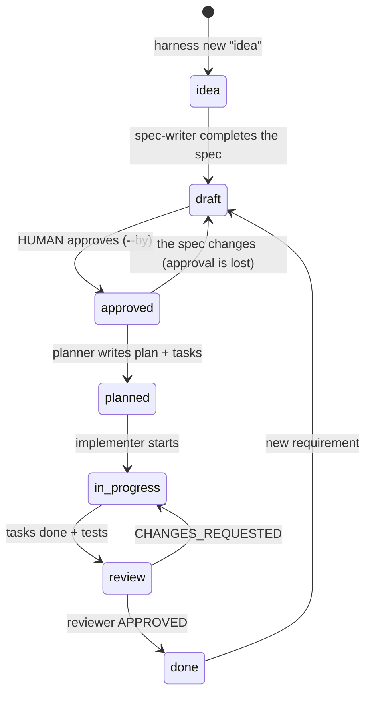
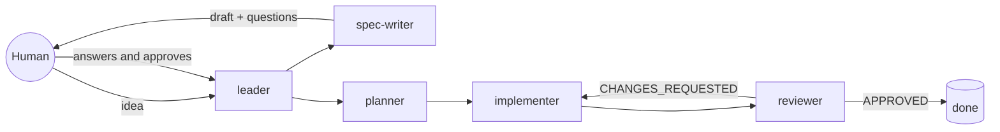

# 5. The framework: specs + harness

The previous guides explain SDD by hand. This repo also ships a **harness**:
the structure, scripts, and rules that let an AI agent (or a person) take an
idea to production following SDD **without skipping steps**, and that leave
every step verified and recorded on disk.

It is inspired by the *Harness Engineering* pattern from
[betta-tech/ejemplo-harness-subagentes](https://github.com/betta-tech/ejemplo-harness-subagentes),
with one central change: **the unit of work is the spec**, not a list of features.

## The three pillars

| Pillar | What it is | Where it lives |
|--------|------------|----------------|
| **1. The repo is the system** | All context and state live in versioned files. | `AGENTS.md`, `specs/`, `progress/`, `docs/project/`, `harness.config.json` |
| **2. Separated roles** | Whoever writes the spec does not approve it; whoever implements does not review themselves. | `harness/agents/*.md` |
| **3. Executable verification** | A program enforces the rules, not the agent's goodwill. | `harness/cli.js`, `.cursor/hooks.json`, `.claude/settings.json`, `CHECKPOINTS.md` |

## The lifecycle of a spec

Each `spec.md` has a `status` in its frontmatter. It only changes with
`npm run harness -- move <id> <status>`, which evaluates the **gate** of the
target status and refuses if it is not met.



| To reach… | The gate requires |
|-----------|-------------------|
| `approved` | At least one `**AC-n**`, no open `- [ ]` questions, and `approved_by` (a human). |
| `planned` | The above + `plan.md` + `tasks.md` with tasks + **each AC mentioned in some task**. |
| `in_progress` | The above + no other spec in `in_progress`. |
| `review` | The above + every task `[x]` + **each AC with an `[AC-n]` test** + green tests. |
| `done` | The above + `progress/review_<id>.md` with `**Verdict:** APPROVED`. |

You cannot skip statuses forward. Backward is allowed: going back to `draft`
clears `approved_by`, so **every spec change requires a new approval**.

## The roles



Each role lives in `harness/agents/<role>.md` with its protocol and hard rules.
Subagents **write their report in `progress/`** and return a single line
(`done -> progress/impl_001.md`). That way context does not degrade as it
passes through chat, and everything stays auditable.

## The commands

```bash
npm run harness -- new "<idea>" --title "<title>"   # creates specs/NNN-slug/spec.md in idea status
npm run harness -- status          # where each spec is and what comes next
npm run harness -- next-ac         # next free criterion ID
npm run harness -- plan 001        # creates plan.md and tasks.md from the templates
npm run harness -- move 001 draft  # changes status if the gate passes
npm run harness -- check           # full verification (at start and close)
npm run harness -- trace           # AC ↔ tests traceability only
```

## Agent hooks (Cursor and Claude Code)

Two hooks make two rules independent of whether the agent respects them.
Each agent has its own copy, because each one speaks a different hook protocol:

| Hook | Cursor (`.cursor/hooks.json`) | Claude Code (`.claude/settings.json`) |
|------|-------------------------------|---------------------------------------|
| `guard-approval.sh` | `beforeShellExecution` | `PreToolUse` on `Bash` |
| `check-on-stop.sh` | `stop` | `Stop` |

- **`guard-approval.sh`**: if an agent runs `harness move <id> approved`, the
  agent asks you for confirmation (in Claude Code, even in auto mode). The approval is yours.
- **`check-on-stop.sh`**: when the agent finishes, it runs `harness check`.
  If it is red, it returns the errors so the agent can fix them or document the block.
  It does this once per stop, so an unresolvable block never loops forever.

## Why the reviewer is needed if everything is green

When this harness was tried on a sample project (a URL shortener with every
criterion tested and every test green), a fresh reviewer in each round, without
the implementer's context, rejected it three times:

| Review | What it found |
|--------|---------------|
| 1st | The code performed validations the spec did not ask for, and a "in bytes" limit counted characters. |
| 2nd | A path with a trailing slash (`/abc/`) returned a valid result instead of the 404 a criterion required. |
| 3rd | Paths like `//evil/abc` or `/x/../abc` reached real endpoints because of how the URL was parsed. |
| 4th | **APPROVED**. |

None of those defects is caught by automatic traceability, because there was a
test per criterion and everything passed. That is why there are two levels: ⚙️
what the program verifies and 👀 what the reviewer judges (see `CHECKPOINTS.md`).

There are two lessons:

- **If the change is behavioral**, the spec goes back to `draft`, the criteria
  are added, a human re-approves it, and only then is the code touched.
- **If it is a bug against a clear spec**, going back to `in_progress` is enough:
  failing test first, then the fix.

## How to use it in your project

It works with any stack. It only needs Node ≥ 20 to run the harness.

1. Copy this repo as the base of your project, or copy these files into an existing one:

   ```
   harness/                 # CLI + roles (do not touch)
   templates/               # spec, plan, and task templates (adjustable)
   AGENTS.md  CLAUDE.md  CHECKPOINTS.md
   .cursor/hooks.json  .cursor/hooks/      # if you use Cursor
   .claude/settings.json  .claude/hooks/   # if you use Claude Code
   harness.config.json      # ← adapt
   docs/project/            # ← fill in: architecture, conventions, verification
   progress/current.md  progress/history.md
   specs/
   ```

   If your project already has `package.json`, add the script `"harness": "node harness/cli.js"`.

2. Fill in `docs/project/*.md`.
3. Adapt `harness.config.json`. Example for Python with pytest:

   ```json
   {
     "project": "my-api",
     "specsDir": "specs",
     "templatesDir": "templates",
     "progressDir": "progress",
     "tests": { "dirs": ["tests"], "extensions": [".py"] },
     "verify": [
       { "name": "lint", "run": "ruff check ." },
       { "name": "tests", "run": "pytest -q" }
     ],
     "requiredFiles": ["AGENTS.md", "CHECKPOINTS.md", "docs/project/architecture.md"]
   }
   ```

   In Python, the `[AC-n]` reference can go in the docstring or in a comment
   on the test (`def test_rejects_expired_link():  # [AC-4]`). The harness
   looks for `[AC-n]` in the file text, regardless of language.

4. `npm run harness -- check` green and you can start your first idea (see [the walkthrough](04-exercise.md)).
